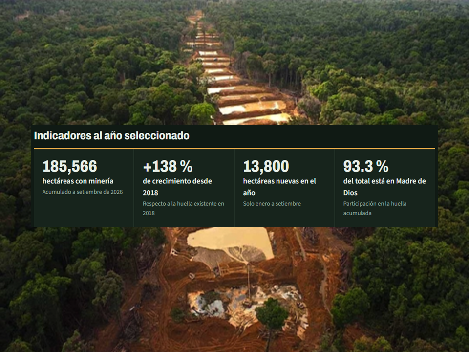
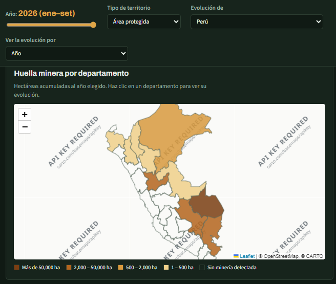

# La huella del oro en la Amazonía peruana (2018–2026)

**Tarea 3 – Python Intermedio** · Lizbeth Huaman

## 1. Tema y pregunta de investigación

**Tema:** expansión de la minería aurífera en la Amazonía peruana.

**Pregunta:** ¿Dónde y a qué ritmo avanza la minería aurífera en la Amazonía peruana, y cuánto presiona sobre áreas protegidas y territorios indígenas?

**Cobertura:** Amazonía peruana, de 2018 a setiembre de 2026.

## 2. Descripción

Proyecto de análisis y divulgación de datos satelitales sobre minería de oro. Incluye un dashboard interactivo con mapa, indicadores y filtros, y un reel narrado con mi voz clonada mediante IA.




## 3. Fuentes y metodología

**Fuentes**
- [Amazon Mining Watch](https://github.com/earthrise-media/mining-detector) (Earth Genome, Amazon Conservation y Pulitzer Center): hectáreas de minería detectadas por jurisdicción y periodo. Publicación del 19/10/2026. Licencia CC BY 4.0.
- Límites departamentales del Perú (INEI), versión simplificada de [juaneladio/peru-geojson](https://github.com/juaneladio/peru-geojson).

**Metodología**
1. `obtener_datos.py` descarga los datos originales.
2. `procesar_datos.py` filtra el Perú (518 registros), revisa duplicados (0), separa año y trimestre, traduce y limpia nombres, y valida que la suma de hectáreas nuevas coincida con el acumulado final (diferencia máxima: 0.02 ha).
3. `analizar_datos.py` calcula los KPIs y hallazgos, y exporta los datos para el dashboard (`web/data/datos.json`).

## 4. Hallazgos principales

1. **La minería más que se duplicó.** La huella pasó de 77,890 ha en 2018 a 185,566 ha en setiembre de 2026 (+138 %). De enero a setiembre de 2026 se detectaron 13,800 ha nuevas, un 30.6 % más que en el mismo periodo de 2025.
2. **Se expande fuera de Madre de Dios.** Madre de Dios concentra el 93.3 % de la huella, pero la minería nueva en otras regiones pasó de entre 5 y 8 % del total anual (2019–2023) a 24.8 % en 2025. Huánuco pasó de 17 a 4,736 ha, casi todo en la zona de amortiguamiento de la Reserva Comunal El Sira.
3. **La minería rodea las áreas protegidas.** Dentro de ellas hay 2,636 ha; en sus zonas de amortiguamiento, 56,454 ha (unas 21 veces más). En territorios indígenas hay 31,638 ha; el más afectado es San José de Karene (8,966 ha).

## 5. Limitaciones

- Según Amazon Mining Watch, el modelo sobreestima el área entre 1.5 y 1.7 veces; las comparaciones entre periodos son más confiables que los totales.
- Los periodos recientes pueden revisarse, y el primer trimestre coincide con la temporada de lluvias y nubes.
- No se detecta la minería en ríos (dragas) ni la minería andina, el enfoque está en la Amazonía.
- El valor de 2018 incluye toda la minería existente hasta ese año.
- Áreas protegidas y territorios indígenas pueden superponerse; sus cifras no se suman.

## 6. Enlaces

- **Dashboard:** https://lizzie28-beep.github.io/python-intermedio/tarea_3/web/
- **Reel:** [reel/reel.mp4](reel/reel.mp4)
- **Publicación de LinkedIn:** https://lnkd.in/p/e23YzJ42

## 7. Cómo reproducir el proyecto

```bash
python -m venv .venv
.venv\Scripts\activate         
pip install -r tarea_3/requirements.txt

python tarea_3/scripts/obtener_datos.py
python tarea_3/scripts/procesar_datos.py
python tarea_3/scripts/analizar_datos.py
```

Luego copia `datos/originales/peru_departamental.geojson` a `web/data/` y abre el dashboard con un servidor local:

```bash
cd tarea_3/web
python -m http.server
```

y entra a http://localhost:8000.

## 8. Uso de inteligencia artificial y créditos

- **Claude (Anthropic):** apoyo para buscar fuentes de datos, estructurar los scripts, crear la plantilla del dashboard y revisar el guion.
- **Qwen3-TTS (Alibaba):** narración generada en la demo oficial de Hugging Face, clonando mi voz a partir de una grabación de unos 20 segundos. La grabación original no se publica por privacidad.
- **CapCut:** edición del video y subtítulos.

Verifiqué todas las cifras del dashboard y del reel contra los resultados de `analizar_datos.py`.

**Créditos del reel**
- Imagen satelital: "Illegal Mining, Peru, 2016-01-29", Planet Labs, Inc., CC BY-SA 4.0, vía Wikimedia Commons.
- Música: "Documentary" – Tatamusic (Sosin Mykola), vía Pixabay.
- Mapa base del dashboard: © OpenStreetMap.